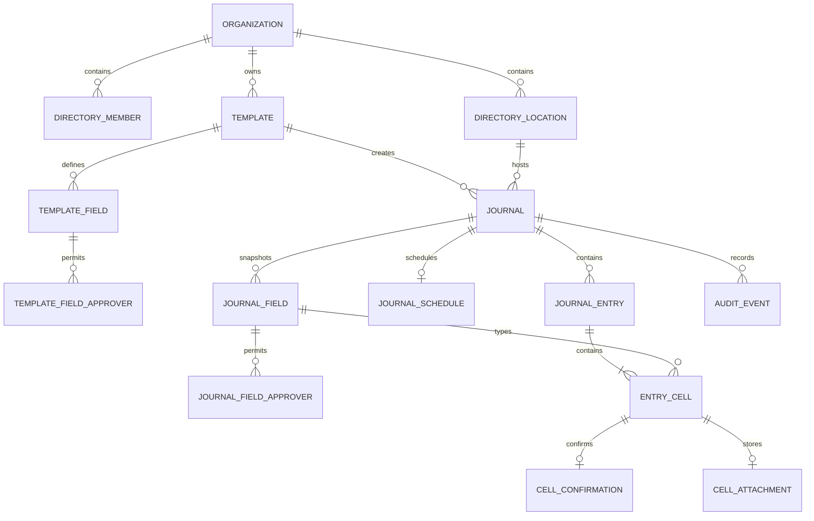

# Схема БД конструктора журналов

Задание № 19 календарного плана. Ответственный — Швецов Никита. Дата проектирования — 17.11.2026.

Основания — файл «календарный план работ.txt», приложенный «journal-field-types.md», [контракт каталога](API_SPEC_parent_service.md) и [контракт входа](39_CLEARBARN_SIGN_IN_SERVICE_SPEC.md). Документ задаёт модель, ограничения и последовательность миграций для реализации в задании № 24.

## Принятые решения

СУБД — PostgreSQL, миграции — Flyway. Идентификаторы собственных объектов имеют тип UUID и выдаются приложением. ID организаций и филиалов ClearBarn имеют тип bigint, UID сотрудника — UUID. Календарные даты хранятся как date, время действий — timestamptz. Счётчики и версии имеют тип bigint.

Динамические столбцы хранятся отдельными строками схемы. Значения ячеек хранятся в типизированных колонках. Это позволяет использовать внешние ключи, фильтры по датам и числам и сохранять различие между пустым полем, прочерком и ожидающим подтверждением. JSONB используется для снимков внешних DTO, параметров расписания и событий аудита.

При создании журнала столбцы шаблона копируются в journal_field. Правки шаблона распространяются на следующие журналы. Схема созданного журнала неизменяема. Изменение схемы существующего журнала требует отдельного решения о версиях и преобразовании данных.

**Допущение для первой версии.** Один экземпляр журнала относится к одному филиалу. Назначение шаблона нескольким филиалам создаёт отдельный журнал для каждого, с собственными строками и нумерацией. Для правила «руководитель» используется роль ClearBarn owner. Состояния журнала — active, completed, archived. Эти решения следует подтвердить до реализации соответствующих API.

## Связи

На диаграмме показаны основные связи. Все связи предметных данных дополнительно включают organization_id.

Полная ER-диаграмма с ключевыми полями и связями доступна в [database-er.mmd](database-er.mmd). PK обозначает первичный ключ, FK — внешний, UK — уникальный. Метаданные и часть настроек опущены для читаемости, полный состав полей приведён в таблицах ниже. Составные FK описаны в разделе ограничений.

## Общие соглашения

- Во всех таблицах организации обязателен organization_id. PK собственных объектов — (organization_id, id). Идентификатор организации берётся из проверенного серверного контекста.
- FK между объектами включает organization_id. Связи ячеек дополнительно включают journal_id, поэтому поле одного журнала нельзя использовать в строке другого.
- Метаданные изменяемых объектов содержат created_at, updated_at и version с начальным значением 0. Версия увеличивается при изменении. Метаданные действий содержат actor_uid.
- Строки справочников удаляются логически. Для исторических ссылок используются FK с ON DELETE RESTRICT. Физическое удаление рабочих журналов и строк в первой версии закрыто.
- CHECK проверяет обязательные названия через btrim(name) <> ''. Типы и состояния задаются text с CHECK по разрешённым значениям. Для изменения набора значений нужна миграция.
- Индексы для FK создаются отдельно, если их левый префикс уже не покрыт PK или другим индексом.

## Организация и каталог

| Таблица | Поля и ключи | Назначение |
|---|---|---|
| organization | id bigint PK, issuer text NOT NULL, created_at | Локальная организация. В первой версии один настроенный issuer ClearBarn. Поддержка нескольких провайдеров потребует включения issuer в область внешних ключей. |
| directory_member | organization_id, member_uid UUID, full_name text, role text, status text, primary_location_id bigint NULL, external_updated_at timestamptz NULL, is_removed boolean, source_payload jsonb NULL, synced_at. PK (organization_id, member_uid) | Локальная проекция сотрудников. role — owner, manager, employee. status сохраняет значения внешнего контракта. Для исторических ссылок разрешена минимальная строка с UID до получения DTO. У такой строки ФИО и роль могут быть NULL. |
| directory_location | organization_id, location_id bigint, name text NULL, status text NULL, is_removed boolean, external_updated_at timestamptz NULL, source_payload jsonb NULL, synced_at. PK (organization_id, location_id) | Проекция филиалов. DTO в JSONB включает адрес и реквизиты. Минимальная строка с ID возможна до синхронизации. |
| directory_member_location | organization_id, member_uid, location_id. PK по всем трём полям | Состав филиалов из каталога. FK на сотрудника и филиал. |
| directory_sync_checkpoint | organization_id, resource text, subscription jsonb, delta_cursor text NULL, updated_at. PK (organization_id, resource) | Два независимых ресурса members и locations. Непрозрачные курсоры, до 4096 символов. |

primary_location_id связан составным FK с directory_location. Снимок и delta применяются транзакционно. Все страницы нового снимка сначала собираются во временном наборе с идентификатором загрузки. Рабочая проекция заменяется после получения последней страницы. Объекты, исчезнувшие из каталога, помечаются is_removed, их исторические ссылки сохраняются. Изменения и next_cursor фиксируются вместе. Повторное upsert/remove безопасно. При 410 начинается новый снимок соответствующего ресурса.

Локальная проекция служит для отображения и выбора значений. Право на операцию проверяется интроспекцией на каждом защищённом запросе. Состав филиалов каталога может отличаться от текущего разрешённого контекста.

## Шаблоны и снимок журнала

| Таблица | Поля | Ограничения |
|---|---|---|
| template | organization_id, id, name text, status text, created_by_uid, created_at, updated_at, version | status — active или archived. FK автора на directory_member. |
| template_field | organization_id, id, template_id, position integer, type text, name text, required boolean, placeholder text NULL, fill_mode text, min_value numeric NULL, max_value numeric NULL, confirmation_rule text NULL, confirmation_timing text NULL | FK шаблона. UNIQUE (organization_id, template_id, position), position >= 0. |
| template_field_approver | organization_id, field_id, member_uid | PK по всем полям. FK на template_field и directory_member. |
| journal | organization_id, id, template_id, template_version bigint, name text, location_id, responsible_uid NULL, status text, next_entry_number bigint DEFAULT 1, created_by_uid, created_at, updated_at, completed_at NULL, archived_at NULL, version | FK шаблона, филиала, ответственного и автора. Счётчик > 0. Завершение и архивация имеют временные метки. |
| journal_field | organization_id, id, journal_id, source_field_id UUID, position, type, name, required, placeholder, fill_mode, min_value, max_value, confirmation_rule, confirmation_timing | Полная копия определения поля. UNIQUE (organization_id, journal_id, position) и (organization_id, journal_id, id, type). source_field_id хранит происхождение без FK на изменяемое поле шаблона. |
| journal_field_approver | organization_id, field_id, member_uid | Снимок списка допустимых сотрудников. PK по всем полям. FK на journal_field и directory_member. |

Поля с одинаковыми названиями разрешены, данные связываются по ID. Правки порядка выполняются с DEFERRABLE UNIQUE для position. Для снимка журнала вставка полей завершается вместе с созданием журнала.

Допустимые type — sequence, text, number, date, next_entry_date, employee, location, image, confirmation, boolean. boolean поддерживает старые данные. Для sequence имя равно «№», значение назначается сервером.

fill_mode принимает manual, current_date, author, author_primary_location. current_date допустим для date, author для employee, author_primary_location для location. Остальные типы используют manual. placeholder применяется к text и number. Границы допустимы для number, min_value <= max_value при наличии обеих границ. Значения numeric для границ должны быть конечными.

confirmation_rule принимает anyone, author, anyone_except_author, manager, owner, manager_or_owner, selected_members. confirmation_timing — on_entry или deferred. Эти поля заполнены только у confirmation. Для selected_members необходим хотя бы один approver. Наличие столбца у шаблона и наличие approver проверяются сервисом и отложенными constraint triggers на момент COMMIT.

## Записи, ячейки и подтверждения

| Таблица | Поля | Ограничения |
|---|---|---|
| journal_entry | organization_id, id, journal_id, number bigint, author_uid, created_at, updated_at, version | UNIQUE (organization_id, journal_id, number), UNIQUE (organization_id, journal_id, id). number > 0. FK автора. |
| entry_cell | organization_id, journal_id, entry_id, field_id, field_type text, state text, text_value text NULL, number_value numeric NULL, date_value date NULL, member_uid UUID NULL, location_id bigint NULL, boolean_value boolean NULL | PK (organization_id, journal_id, entry_id, field_id). FK (organization_id, journal_id, entry_id) на journal_entry и (organization_id, journal_id, field_id, field_type) на journal_field. Составные FK на сотрудника и филиал. |
| cell_confirmation | organization_id, journal_id, entry_id, field_id, confirmer_uid UUID, full_name_snapshot text, role_snapshot text, confirmed_at timestamptz | PK совпадает с ключом ячейки, FK на entry_cell и directory_member. ФИО и роль фиксируются на момент действия. |
| cell_attachment | organization_id, journal_id, entry_id, field_id, storage_key text, original_name text, media_type text, size_bytes bigint, sha256 text, created_at | PK совпадает с ключом ячейки. FK на entry_cell. UNIQUE (storage_key), 0 < size_bytes <= 1048576. |

state принимает empty, skipped, pending, filled. Для empty и skipped все колонки значений пусты. pending допускается только для confirmation и означает ожидание. filled означает наличие значения соответствующего типа. В одной ячейке используется ровно одна колонка значения. Для sequence используется number_value, равный номеру строки. Для confirmation и image данные находятся в связанных таблицах.

CHECK проверяет соответствие field_type и заполненных колонок, конечность числа и допустимость state. CHECK запрещает skipped для sequence. date и next_entry_date используют date_value. boolean_value=false сохраняется как заполненное значение. Текст хранится с обрезанными крайними пробелами. Для текста отсутствуют ограничения длины и формата.

Обязательное поле может иметь state=skipped. Для необязательного пустого поля используется empty. pending разрешён только при deferred. Для on_entry подтверждение требуется при сохранении строки, если ячейка явно не пропущена.

Отложенный constraint trigger проверяет к COMMIT полноту матрицы «одна ячейка на каждое поле журнала», required с учётом skipped, номер строки и соответствие filled наличию подтверждения или вложения. Для skipped/pending/empty связанных объектов быть не должно. Функция проверки вызывается при изменении ячейки и связанных объектов. Схема журнала блокируется от изменения после создания.

Число вне min/max сохраняется. Предупреждение вычисляется при чтении по неизменяемым границам journal_field. Ноль сохраняется как 0. Текст из пробелов считается пустым. Для автодаты используется переданная браузером календарная дата на момент сохранения. Автор определяется по сессии, автоматические employee и location вычисляет сервер.

Подтверждающий определяется по текущей сессии. Правило проверяется при действии с учётом автора строки и свежего контекста доступа. Для selected_members и manager_or_owner достаточно одного подходящего сотрудника. PK cell_confirmation исключает второе подтверждение, а сервис закрывает переход из skipped или filled. Наличие UID в запросе само по себе не даёт права подтверждения.

В media_type допустимы image/png, image/jpeg, image/webp, image/gif, image/avif. Сервер проверяет содержимое, размер и возможность чтения. storage_key указывает на серверное файловое или объектное хранилище. Перед транзакцией файл помещается во временное хранилище и проверяется. Готовый объект публикуется до фиксации ссылки в БД. При откате остаётся объект без ссылки, который удаляется уборщиком после безопасного интервала. Выдача файла проверяет права на журнал. Публичный URL в таблице отсутствует.

## Расписание и история

| Таблица | Поля | Ограничения |
|---|---|---|
| journal_schedule | organization_id, journal_id, starts_on date, ends_on date NULL, frequency text, interval_count integer, weekdays smallint[] NULL, month_days smallint[] NULL, last_day boolean, dates date[] NULL, times varchar[] NULL, version | PK (organization_id, journal_id), FK журнала. interval_count > 0, ends_on >= starts_on. |
| audit_event | organization_id, id, journal_id NULL, template_id NULL, entry_id NULL, event_type text, actor_uid UUID, actor_name_snapshot text, actor_role_snapshot text, occurred_at timestamptz, before_data jsonb NULL, after_data jsonb NULL, request_id UUID | FK организации, журнала, шаблона, сотрудника. Ссылка на строку включает journal_id. Запись добавляется в транзакции действия. |

В БД используются значения frequency: none, once, day, week, month, year, custom. Для week задаются уникальные дни 1…7, для month — числа месяца 1…31 и/или признак последнего дня, для year — одно число месяца, а месяц берётся из starts_on. Для custom задаются конкретные даты начиная с starts_on. Контракт создания и редактирования описан в [README бэкенда](../backend/README.md).

График рассчитывается на запрошенный интервал по расписанию и date_value полей next_entry_date **последней сохранённой строки** активного журнала. Последняя строка определяется максимальным number. Если в ней прочерк, предыдущая строка не используется. Совпавшие даты объединяются по (journal_id, date). Материализация всех будущих дат в БД не требуется.

Audit сохраняет снимки данных действия и позволяет читать прежние значения. Обновление и удаление событий закрываются для прикладной роли БД. В события исключаются токены, cookie, секреты и двоичное содержимое файлов. Политика исправления уже подтверждённых строк требует согласования. До её определения подтверждённые строки доступны для чтения.

## Транзакции и конкурентные операции

Добавление строки блокирует journal через SELECT FOR UPDATE, повторно проверяет active, получает next_entry_number, увеличивает его и сохраняет строку, ячейки и аудит одной транзакцией. Откат откатывает счётчик. Физическое удаление строк запрещено, поэтому номера сохраняют порядок.

Подтверждение и завершение используют ту же блокировку journal. Завершение проверяет все ячейки confirmation, допускает filled или skipped и переводит журнал в completed. Это исключает вставку неподтверждённой строки одновременно с завершением.

Редактирование шаблона и метаданных журнала выполняется с условием WHERE version = ожидаемая_версия. При отсутствии обновлённой строки API возвращает конфликт 409. Создание журнала читает шаблон в согласованном снимке транзакции REPEATABLE READ либо под блокировкой шаблона, которую обязаны брать и редакторы его полей.

Повтор запросов после сетевого обрыва следует согласовать в задании № 73. Для идемпотентных команд потребуется отдельный ключ операции, связанный с организацией, пользователем, хешем запроса и результатом. Уникальность номера защищает целостность, но сама по себе не распознаёт повтор одной команды.

## Индексы и изоляция

| Выборка | Индекс |
|---|---|
| Список журналов филиала | journal (organization_id, location_id, status, created_at DESC, id) |
| Журналы по шаблону | journal (organization_id, template_id) |
| Список шаблонов | template (organization_id, status, name, id) |
| Строки журнала | UNIQUE journal_entry (organization_id, journal_id, number) |
| Строки по периоду | journal_entry (organization_id, journal_id, created_at, id) |
| Фильтр динамических дат | entry_cell (organization_id, journal_id, field_id, date_value, entry_id) WHERE state = 'filled' |
| Фильтр чисел | entry_cell (organization_id, journal_id, field_id, number_value, entry_id) WHERE state = 'filled' |
| Неподтверждённые ячейки | entry_cell (organization_id, journal_id, state) WHERE field_type = 'confirmation' |
| История журнала | audit_event (organization_id, journal_id, occurred_at DESC, id) |
| История шаблона | audit_event (organization_id, template_id, occurred_at DESC, id) |

Составные FK исключают связь с объектом другой организации. Все запросы дополнительно фильтруются по подтверждённой организации. Для филиальных операций проверяется location_id журнала по allowed_location_ids для каждой роли. Та же проверка действует для прямых ID, вложений, истории и экспорта. Кеш каталога и FK обеспечивают согласованность ссылок, текущие права проверяет сервис.

Сессии и транзакции OIDC хранятся на сервере. При выборе JDBC-хранилища использовать стандартную схему Spring Session отдельной миграцией после выбора библиотеки. Сессия содержит проверенные iss/sub, организацию, токен и его срок. Срок сессии ограничивается сроком токена. Учётные данные интеграций задаются конфигурацией окружения.

## План миграций

| Версия | Содержание |
|---|---|
| V1__create_directory.sql | organization, directory_location, directory_member, directory_member_location, directory_sync_checkpoint и составные FK. |
| V2__create_templates.sql | template, template_field, template_field_approver, проверки настроек и отложенные проверки полноты шаблона. |
| V3__create_journals.sql | journal, journal_field, journal_field_approver, journal_schedule, проверки снимка и запрет его изменения. |
| V4__create_entries.sql | journal_entry, entry_cell, cell_confirmation, cell_attachment, проверки типов и отложенные проверки полноты записи. |
| V5__create_audit.sql | audit_event, индексы истории и ограничения изменения событий для прикладной роли. |
| V6__create_query_indexes.sql | Индексы списков, графика и фильтрации, отсутствующие после создания PK/UNIQUE/FK. |
| V7__extend_journal_schedule.sql | Варианты расписания для API создания и редактирования журналов. Прежнее число месяца переносится в массив чисел. |
| V8__index_unresolved_confirmations.sql | Частичный индекс по организации и журналу для проверки неподтверждённых ячеек при закрытии. |

Все V1–V6 создаются в задании № 24 в backend/src/main/resources/db/migration. Схема создаётся Flyway, для Hibernate задаётся ddl-auto=validate. Применённые миграции сохраняют содержимое, изменения оформляются следующей версией. Данные демонстрации отделяются от рабочих миграций.

Проверка миграций должна включать пустую БД и обновление предыдущей версии с данными. Для изменяемой структуры сначала добавляются совместимые колонки, затем заполняются данные, затем вводятся обязательность и ограничения. Перед выпуском проверяется восстановление из резервной копии.

## Приёмка схемы

1. Изменить шаблон после создания журнала и убедиться, что старые столбцы и значения читаются по снимку journal_field.
2. Попытаться связать строку с полем другого журнала и другой организации. Составной FK должен отклонить обе операции.
3. Сохранить required со skipped, необязательный empty и confirmation с pending. Проверить различие состояний при чтении и экспорте.
4. Проверить ноль, отрицательное число, границы и число вне диапазона. Проверить отклонение NaN и бесконечностей, невозможной даты и прочерка у sequence.
5. Двумя транзакциями добавить строки. Номера должны различаться, откат одной транзакции должен откатить её счётчик.
6. Попытаться завершить журнал с pending, затем подтвердить ячейку и повторить завершение. Проверить параллельную вставку и завершение.
7. Повторить подтверждение, привязать два файла к ячейке и вставить запись без обязательной ячейки. Ограничения должны отклонить операции.
8. Применить повторную delta, remove и новый снимок каталога. История должна сохранять UID, ID филиалов и снимки подтверждений.

Эти сценарии задают требования к проверке реализации в задании № 24. Физические миграции и проверки на работающей БД относятся к следующему этапу.
